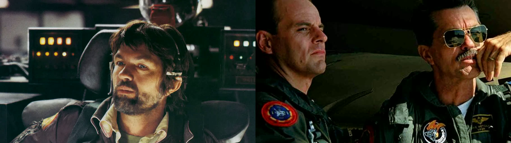

in memory of Tom Skerrit

Tom Skerrit's characterizations in Alien (1979) and Top Gun (1986) were an anchor to the storyline and are just unforgettable.

"Keep sending him up"

[withmarbleapp/os-taxonomy](https://github.com/withmarbleapp/os-taxonomy)
> An open, structured taxonomy of **what children learn** across the primary/elementary years

[Migrating from nvm to mise](https://huguesverlin.fr/blog/nvm-to-mise/)
> [mise](https://mise.jdx.dev/) is a tool version manager and a task runner. It replaces tools like `asdf`, `nvm`, `pyenv`, `sdkman`, `rbenv`, …

[NVIDIA/personaplex](https://github.com/NVIDIA/personaplex)
> PersonaPlex is a real-time, full-duplex speech-to-speech conversational model that enables persona control through text-based role prompts and audio-based voice conditioning
